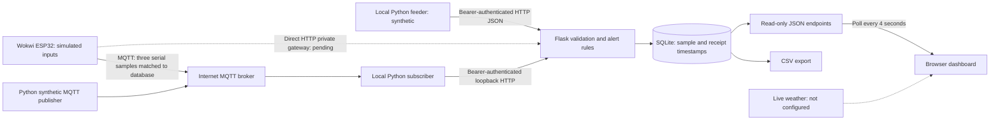

# Prototype architecture

The perception layer is a generator or simulated ESP32. Direct HTTP transports a bounded JSON sample and local bearer token. The MQTT alternative transports a bounded synthetic JSON sample through an internet broker; a local subscriber supplies the HTTP bearer token without placing that token on MQTT. Processing validates the input and calculates demonstration warnings; storage retains accepted records; the application layer presents current conditions and recent history.

The laptop-local Python path can be tested without Wokwi. Direct ESP32 HTTP requires a reachable private gateway; the MQTT alternative requires an internet broker and a subscribed laptop bridge. Both require matching accepted sample evidence before claiming Wokwi delivery. A disconnected ESP32 can still run its local LED/buzzer logic, subject to short connection-attempt delays, but offline samples are not buffered by this starter. The latest display is chosen by sample time rather than arrival time. A replay with the same device/timestamp is rejected. Device source labels are self-reported.

| Choice | Alternative | Reason / limit |
| --- | --- | --- |
| Flask + HTTP plus optional MQTT bridge | Direct HTTP only | MQTT avoids the laptop reachability problem; the shared test broker lacks publisher authentication. Private TLS/device ACLs remain a deployment step |
| SQLite | PostgreSQL / cloud database | Local durability with no service setup; not a multi-farm production design |
| Vanilla JS + SVG | Framework + chart service | No package build or external CDN needed; browser QA still required |
| Bearer token + loopback | Device certificates / authenticated users | Appropriate local prototype; reads have no user login and remote deployment needs stronger access control |
| Explicit weather-unavailable state | Silent synthetic fallback | Shows missing context honestly; actual forecast integration remains work |

Technical references consulted: [Flask application factories](https://flask.palletsprojects.com/en/stable/patterns/appfactories/), [Flask testing](https://flask.palletsprojects.com/en/stable/testing/), [Wokwi networking](https://docs.wokwi.com/guides/esp32-wifi), [Wokwi project configuration](https://docs.wokwi.com/vscode/project-config). These support implementation choices, not claims of agronomic effectiveness.
